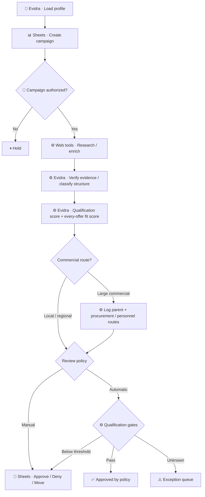
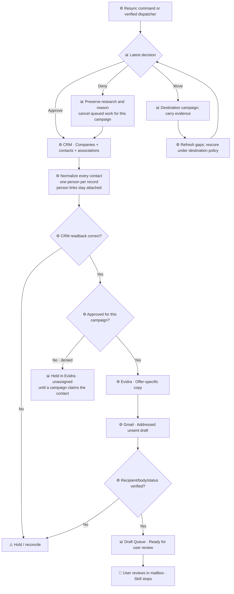

# Workflow diagrams
## Contents
- Start and qualification
- Decisions and execution
- Legend
## Start and qualification

## Decisions and execution

## Legend
⚙️ Automatic inside authorized scope; 👤 user decision; ⚠️ exception; 📊 campaign store; 🧠 skill.
A scheduled dispatcher is optional and must be actually configured. Manual resync works without one.
Deny applies to the campaign only: no contact information is removed. Denied contacts are still written to the CRM and held in Evidra, unassigned, until a campaign claims them; they receive no outreach.
Neither diagram includes sending. Mailbox labels are capability-gated; the review queue is the default.

